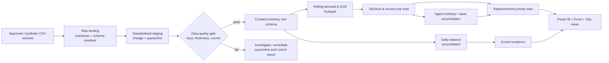
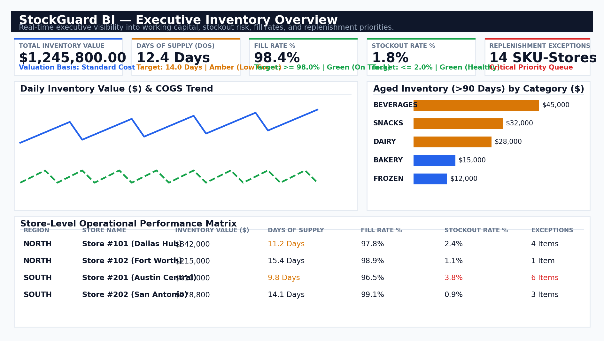
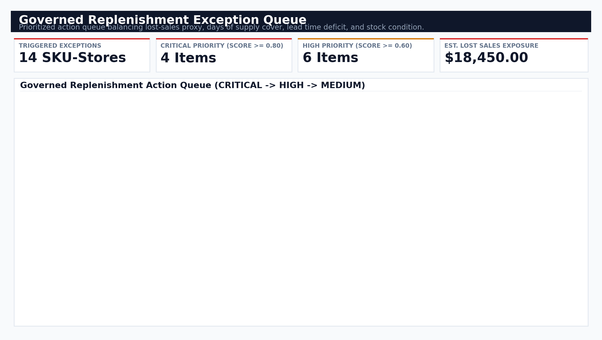
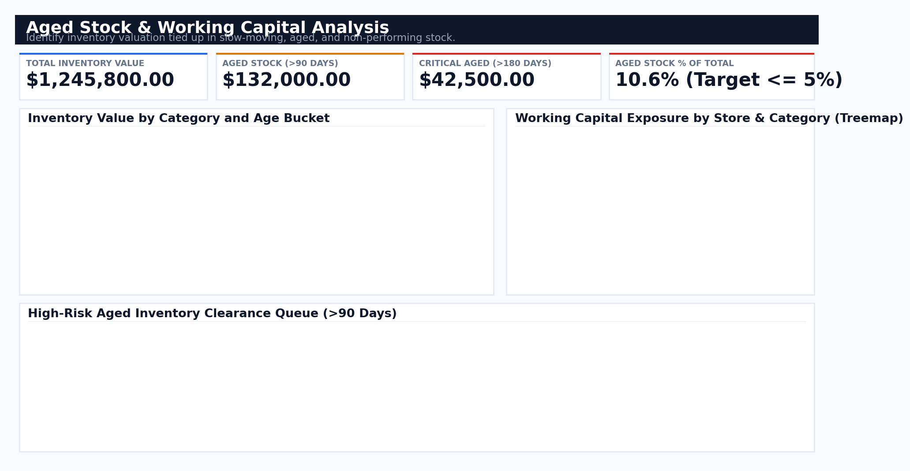
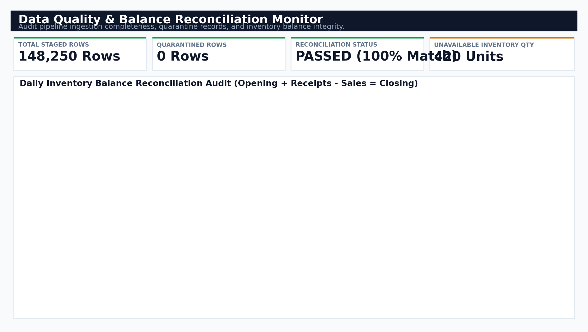

# StockGuard BI — Inventory Health, Replenishment & Stockout Risk Analytics

StockGuard BI is a governed inventory analytics portfolio project that turns daily inventory positions and movements into a decision layer for stockout prevention, replenishment prioritisation, and working-capital control.

## The problem

Inventory teams commonly have data split across ERP inventory, sales, receiving, transfer, product, and store systems. That makes it difficult to answer, consistently and early enough: what will stock out, what should be replenished first, and where is cash tied up in excess or ageing stock.

This project establishes a traceable path from source extracts to a curated star schema, control evidence, analytical marts, and Power BI/Excel decision surfaces. It is built for Inventory Planning (replenish, defer, or rebalance), Store Operations (act on zero-stock and low-cover conditions), and Finance (investigate excess, aged stock, and valuation reconciliation).

## Portfolio highlights

- Daily SKU × store inventory model with traceable raw, staging, and curated run partitions.
- 28-day rolling demand and Days of Supply (DOS), including explicit zero-demand and incomplete-history states.
- Governed stockout, low-cover, excess, aged-stock, and ranked replenishment-exception outputs.
- Data-quality, source-to-staging, balance-reconciliation, and UAT controls with retained evidence.
- Power BI semantic model, reusable SQL views, and an Excel planning companion.

## Architecture and data flow



See the standalone [architecture and data-flow diagram](docs/architecture_data_flow.md) for grains, controls, and publication gates.

## Data provenance and governance

The repository ships a small, non-sensitive representative CSV fixture for repeatable development and testing. It is not production ERP data. The production-ready landing contract expects Inventory, Commercial Analytics, Merchandising, Store Operations, and Procurement source owners to supply approved extracts after daily source close.

| Source domain | Main entities | Accountability |
| --- | --- | --- |
| Inventory / ERP | snapshots, receipts, transfers | Supply Chain / ERP inventory owner |
| Sales / demand | daily sales and fulfilment | Commercial Analytics |
| Product master | SKU, hierarchy, status, cost | Merchandising data owner |
| Store master | location, region, status | Store Operations |
| Replenishment setup | lead time, safety stock, target stock | Inventory Planning / Procurement |

Raw production extracts, credentials, personal data, and confidential supplier terms must never be committed. The detailed [raw-data policy](data/raw/README.md), [source manifest](data/raw/source_manifest.yml), and [source-to-target mapping](docs/source_to_target_mapping.md) document the contract.

## Data model

The curated model is a star schema with deterministic surrogate keys and immutable run IDs.

| Table | Grain | Purpose |
| --- | --- | --- |
| `dim_date` | calendar date | Calendar and working-day attributes. |
| `dim_sku` | SKU | Product hierarchy, UOM, status, cost. |
| `dim_store` | store / location | Operational location hierarchy and status. |
| `dim_reorder_parameter` | SKU × store × effective date | Lead time, safety stock, reorder settings. |
| `fact_inventory_daily` | SKU × store × business date | On-hand, allocated, unavailable, in-transit, cost, age. |
| `fact_sales_daily` | SKU × store × sale date | Requested, fulfilled, sold, returned, sales, COGS. |
| `fact_receipts` | receipt line | Received quantity, cost, lot, date. |
| `fact_transfers` | transfer line | Origin, destination, quantity, status, expected receipt. |

For business keys, relationship rules, and dimensional-history assumptions, see [the schema guide](docs/star_schema.md).

## Controls and test evidence

Publication is gated by explicit controls rather than silent defaults:

- Required fields, numeric validity, freshness, duplicate snapshot keys, and valid SKU/store master references.
- Source row count = staged rows + quarantined rows.
- Daily inventory balance: opening + receipts + received transfers − outbound transfers − sales + adjustments = closing.
- Initial/gapped snapshots are `NOT_EVALUATED`, rather than manufactured as passing balances.
- Risk and replenishment marts retain setup/input exceptions instead of scoring with assumed data.
- Stakeholder UAT covers absent sales, zero stock, late receipts, duplicate snapshots, unknown SKUs, reconciliation success, and breach handling.

Read the [data-quality controls](docs/data_quality_controls.md), [reconciliation contract](docs/inventory_reconciliation.md), and [UAT pack](uat/inventory_uat_cases.md). Reconciliation and benchmark evidence is retained under [UAT evidence](uat/evidence/).

## Techniques used

**PySpark.** Rolling demand uses a 28-day SKU-store window, calendar completeness checks, broadcast joins for the smaller daily-sales aggregation, partition alignment, and adaptive query execution. The optimised implementation was 1.23×–1.70× faster than the baseline across retained 14k–700k-row benchmarks. Details: [performance evidence](uat/evidence/performance_evidence.md).

**SQL.** PostgreSQL-compatible views publish on-hand availability, sell-through, fill rate, 365-day turns, 28-day stockout rate, trend metrics, stock risk, and replenishment summaries. Analytical ratios are recalculated from additive numerators and denominators at rollup, never averaged. See [SQL KPI views](docs/sql_kpi_views.md) and `marts/`.

**Decision logic.** DOS is null for zero/unavailable demand, active stockouts remain visible even with zero demand, risk cover is evaluated against lead time plus safety stock, and replenishment urgency blends lost-sales proxy, DOS, lead-time deficit, value/margin, and stock condition. Definitions and owners live in the [KPI catalog](docs/kpi_catalog.md).

## Dashboard previews

These are static design previews generated from synthetic illustrative values; they demonstrate the report layout and intended decisions, not measured production results.

| Executive inventory health | Replenishment action queue |
| --- | --- |
|  |  |

| Aged stock and working capital | Data quality and reconciliation |
| --- | --- |
|  |  |

The editable Power BI project is in `powerbi/StockGuardBI.pbip`; report pages, relationships, and DAX measures are versioned alongside it. See [semantic-model documentation](docs/powerbi_semantic_model.md).

## Insights and recommendations

The supplied representative fixture is deliberately small, so its EDA is directional rather than an operational finding: SKU-100 has the highest observed demand (12 units) and inventory value (562.50), with no observed input missingness. See [EDA summary](reports/eda_summary.md).

For a production data release, the recommended operating rhythm is:

1. Triage `CRITICAL` and `HIGH` replenishment exceptions after daily close; confirm inbound status before expediting or transferring stock.
2. Investigate active stockouts and low-cover SKU-stores with valid demand first; retain zero-demand items for planner review rather than creating artificial DOS.
3. Review excess and aged value by category/store with Finance; decide among transfer, markdown, return, or write-off using approved valuation.
4. Resolve duplicate keys, unknown SKUs, source lateness, and reconciliation exceptions before publishing the report.
5. Agree and version production thresholds for lead time, safety stock, valuation, and priority weights with their named owners.

## Limitations

- The checked-in fixture is representative and only covers a small historical slice; it is unsuitable for forecasts, volume claims, or operational action.
- The project does not create purchase orders, transfers, or write-back transactions; recommendations require human approval in source systems.
- Lost sales are not imputed; observed fulfilment is the demand input until an approved demand signal is supplied.
- Currency conversion, customer-level data, and intraday refresh are out of scope.
- Dimensions are current-extract Type 1; historical Type 2 tracking is a future enhancement.
- Benchmarks are comparative local engineering evidence, not a production SLA.

## Quick start and reproducible demo

Prerequisites: Python 3.9+, Java 17 for PySpark tests/benchmarks, and `pip`.

```bash
git clone https://github.com/xvipull/StockGuardBI.git
cd StockGuardBI
python3 -m venv .venv
source .venv/bin/activate
pip install -r requirements.txt

# Runs raw landing → staging → quality gate → star schema → reconciliation.
python3 scripts/run_portfolio_demo.py --output-dir /tmp/stockguard-demo

# Full automated verification, including UAT controls.
python3 -m unittest \
  tests.unit.test_raw_inventory_ingestion \
  tests.unit.test_inventory_staging \
  tests.unit.test_inventory_data_quality \
  tests.unit.test_inventory_star_schema \
  tests.unit.test_inventory_reconciliation \
  tests.unit.test_rolling_demand \
  tests.unit.test_replenishment_exceptions \
  tests.integration.test_inventory_uat_controls
```

The demo prints the paths to its raw/staging/curated/control artifacts and fails if its quality or reconciliation gate does not pass. It never overwrites an existing output directory. For individual pipeline and mart commands, use the linked documentation in `docs/`.

## Resume-ready impact statements

- Built a governed inventory analytics platform that converts daily ERP-style inventory, sales, receipt, transfer, product, and store extracts into a traceable SKU-store decision model for stockout prevention and working-capital management.
- Engineered PySpark rolling-demand and Days-of-Supply logic with complete-history safeguards, broadcast joins, partition tuning, and AQE; retained benchmarks showing 1.23×–1.70× performance improvement across 14k–700k inventory rows.
- Designed data-quality, inventory-balance reconciliation, and stakeholder UAT controls for duplicate snapshots, unknown SKUs, late receipts, zero stock, and no-sales edge cases.
- Delivered a prioritised replenishment exception mart and Power BI semantic/report design connecting stockout risk, excess stock, aged inventory, and Finance-ready value reconciliation.

## Repository map

| Path | Contents |
| --- | --- |
| `src/` | Ingestion, transformation, quality, reconciliation, and analytics code. |
| `marts/` | Reusable SQL views and validation queries. |
| `powerbi/` | PBIP project, semantic model, DAX, and report previews. |
| `docs/` | Data contracts, KPIs, controls, and implementation notes. |
| `uat/` | Stakeholder cases plus reconciliation/performance evidence. |
| `tests/` | Unit and integration tests. |
