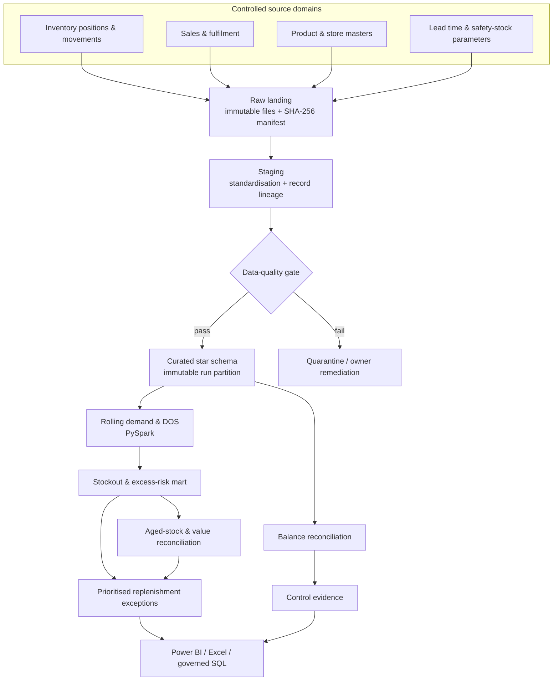

# StockGuard BI architecture and data flow

## Publication gates

| Gate | Evidence | Outcome on failure |
| --- | --- | --- |
| Raw landing | schema check, row count, checksum in `run_manifest.json` | Preserve extract; flag schema failure. |
| Staging | standardisation trace, quarantine file, row-count reconciliation | Correct/reload source; do not silently drop records. |
| Data quality | required fields, numeric validity, duplicate snapshot keys, master-data resolution, freshness | Block curated publication pending accepted remediation. |
| Curated balance | expected versus closing inventory and exception extract | Finance investigates variance beyond tolerance. |
| Analytical marts | risk/aged/replenishment input exceptions and manifests | Surface unscored records; do not fabricate assumptions. |
| Stakeholder UAT | executed cases and owner sign-off | Resolve defects before release. |

## Grain preservation

The operational backbone remains SKU × store × business date from the inventory fact through demand, risk, and aged-stock marts. Sales are aggregated from source line/detail to SKU × store × sale date; receipts and transfers retain their document-line grain. This allows report rollups to recompute ratios from their additive components rather than averaging location-level percentages or DOS values.
